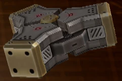

## Related

- [[roles/gamer/identity-under-armor|Identity under armor]]
- [[roles/engineer/engram-working-notes|Engram working notes]]

---

# RAVEN REBEL581 C1-581

AI amplification concept: OP-INTENSIFY HUMAN PLUS.

Index + raven, black and white, international orange highlights. Inverted triangle. Raven soaring or standing on top of the triangle. Human plus. Transhumanism. Long Armored Core association — Armored Core V made it even more significant: a lone warrior who does everything.

Met a raven at the Tower of London, just hanging out; approached because it was a rare chance — it croaked at me inquisitively.

**What ravens symbolize** (researched off the back of that encounter): intelligence, prophecy, death, transformation, and the boundary between worlds — meaning shifts by culture/story. Norse (Huginn/Muninn — thought and memory, watchfulness), Greek/Roman (Apollo, prophecy), Celtic (Morrígan — war, fate, death), Native American/Tlingit/Haida (trickster, creator, bringer of light, transformation), Hebrew Bible (Genesis, survival, divine provision), Christian/European folklore (damned/ghostly souls), Poe's *The Raven* (grief, unending memory). One-sentence version: ravens symbolize intelligence, prophecy, death, transformation, and crossing boundaries — meaning depends entirely on who's telling the story.

Direct thematic tie to [[roles/gamer/identity-under-armor|identity under armor]] — the raven/Armored Core association is the same "self fused with machinery, agency under a system larger than yourself" throughline.

## Dr. Seinyor's world (LEGO Island lore)

Working title: **CHAOS WORLD** / **Mad Adam** (Adam the Mad).

Scrawled notes (scanned handwriting, rough transcription — some words illegible):
- Ninja Turtles / Bandicoots reference points ("massive")
- New Zealand
- Time Cruisers, Magic Mountain
- Gems & rare — "tinker portals," more travelers to other worlds
- The Super Family is the connective tissue between worlds — biomechanical/multiverse crossover, LEGO Island-adjacent
- **Dr. Seinyor's House** — alleged to have been in the residential area of the original 1996 LEGO Island; maybe a post-LEGO-Island sister island on the same watery planet, less developed — more "private island"/hidden-base feeling, Iguazu Falls castle concept

## This world has been connected

The darkness of love and rivalry and coming of age — Kingdom Hearts. The world of the Super Family was connected. Tied to the darkness.

## Funny Guy Side Scroller

Game concept. Inspiration: Vectorman. Prototype in the best available engine.
